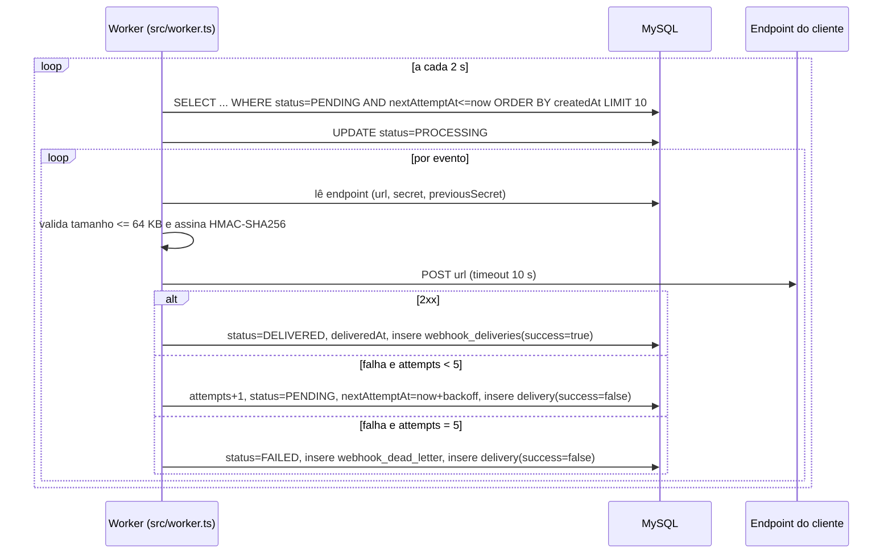

### FDD: Sistema de Webhooks de Notificação de Pedidos

Versão: 1.0
Data: 2026-10-07
Responsável: Larissa (Tech Lead), com Bruno (Pedidos) e Diego (Plataforma)

> Convenções deste documento: cada decisão cita o trecho da reunião (`[hh:mm] Nome`) ou o arquivo do código de onde veio. Itens marcados **[HIPÓTESE]** são detalhes de implementação que a reunião não fechou; estão propostos para validação na revisão com Bruno e Diego ([09:50] Larissa) e na revisão de segurança da Sofia ([09:46] Sofia). A rastreabilidade completa está em [TRACKER.md](TRACKER.md). As decisões de arquitetura estão nos [ADRs](adrs/) e a proposta consolidada no [RFC](RFC.md).

---

### 1. Contexto e motivação técnica

O OMS (Node.js 20, TypeScript, Express, Prisma, MySQL) não tem eventos, filas nem webhooks. Clientes B2B descobrem mudanças de status fazendo polling em `GET /api/v1/orders` ([09:00] Marcos). A feature cria notificações **outbound** ([09:02] Marcos, [09:03] Sofia) disparadas a cada mudança de status.

A mudança de status acontece em `OrderService.changeStatus` (`src/modules/orders/order.service.ts`), dentro de um `prisma.$transaction` que valida a transição (`canTransition` de `src/modules/orders/order.status.ts`), movimenta estoque, atualiza `orders` e insere em `order_status_history`. Essa transação não pode depender de chamadas HTTP externas ([09:04] Bruno).

**Atores**
- Usuário autenticado que representa o cliente e gerencia webhooks pela API ([09:32] Marcos).
- Operador que muda status de pedidos (`PATCH /api/v1/orders/:id/status`, `src/modules/orders/order.routes.ts`).
- ADMIN que reprocessa a DLQ ([09:36] Sofia).
- Worker de webhooks, processo separado ([09:11] Diego).
- Endpoint HTTPS do cliente, que recebe e valida os eventos.

**Limites**
- Só eventos de mudança de status de pedido (`order.status_changed`, [09:43] Diego).
- Só saída: não recebemos webhooks ([09:02] Marcos).

**Suposições e restrições**
- Um único worker em execução nesta fase ([09:12] Diego).
- Mesmo banco e mesma `DATABASE_URL` para API e worker ([09:11] Diego, [09:30] Bruno).
- Nenhuma infraestrutura nova ([09:07] Diego).
- Nenhuma biblioteca nova de log, erro ou validação ([09:29] Bruno, [09:30] Larissa).

---

### 2. Objetivos técnicos

- **Atomicidade status/evento:** para toda mudança de status commitada que interesse a pelo menos um webhook ativo, existe a linha correspondente em `webhook_outbox`; em rollback, não existe nenhuma ([09:06] Diego, [09:40] Bruno).
- **Latência:** tempo entre o commit da mudança de status e a primeira tentativa de entrega menor que 10 s no p95 ([09:02] Marcos), com espera de polling de no máximo 2 s ([09:10] Larissa).
- **Isolamento:** a latência de `PATCH /orders/:id/status` não depende do endpoint do cliente (nenhuma chamada HTTP dentro da transação, [09:04] Bruno).
- **Entrega at-least-once:** todo evento termina em `DELIVERED` ou na DLQ; nenhum é descartado em silêncio ([09:24] Diego, [09:15] Diego).
- **Retry determinístico:** 5 retentativas após a primeira falha com atraso de 1m/5m/30m/2h/12h ([09:17] Larissa).
- **Timeout:** nenhuma chamada ao cliente dura mais de 10 s ([09:42] Diego).
- **Tamanho:** nenhum payload acima de 64 KB é enviado ([09:24] Larissa).
- **Autenticidade:** toda entrega leva `X-Signature` = HMAC-SHA256 do corpo com a secret do endpoint ([09:22] Sofia).
- **Ordem:** eventos do mesmo `order_id` saem na ordem de `created_at` enquanto houver um só worker ([09:12] Diego, [09:13] Larissa).

---

### 3. Escopo e exclusões

**Incluído**
- Tabelas `webhook_endpoints`, `webhook_outbox`, `webhook_deliveries`, `webhook_dead_letter` no `prisma/schema.prisma`.
- Função `publishWebhookEvent(tx, order, fromStatus, toStatus)` chamada por `changeStatus` ([09:41] Bruno).
- Filtro de status na inserção e payload snapshot ([09:34] Bruno, [09:52] Larissa).
- Worker em `src/worker.ts` + `src/modules/webhooks/webhook.worker.ts`, script `npm run worker` ([09:11] Larissa, [09:28] Bruno).
- Assinatura HMAC-SHA256, secret por endpoint, rotação com grace period de 24 h ([09:22] Sofia).
- Retry com backoff, DLQ e replay ADMIN ([09:17] Larissa, [09:18] Diego, [09:36] Larissa).
- API: CRUD de webhooks, rotação de secret, histórico de entregas, replay ([09:31] a [09:35]).
- Códigos de erro `WEBHOOK_*` ([09:29] Larissa).

**Excluído**
- Email de alerta para o cliente quando o webhook falha ([09:37] Larissa). Próxima fase.
- Dashboard ou painel visual ([09:40] Larissa). Projeto do time de frontend.
- Rate limiting de saída ([09:39] Larissa). Observar e decidir depois.
- Arquivamento ou limpeza de linhas entregues após ~30 dias ([09:08] Diego).
- Múltiplos workers, particionamento por `order_id`, lock pessimista e ordering global ([09:13] Diego, [09:13] Larissa).
- Webhooks inbound ([09:02] Marcos).
- Envio de `items` do pedido no payload ([09:43] Diego).
- Exactly-once ([09:25] Diego).
- **[HIPÓTESE]** Evento na criação do pedido: a reunião só cita `changeStatus` ([09:40] Bruno); `OrderService.create` não publica evento nesta fase.

---

### 4. Fluxos detalhados e diagramas

#### 4.1 Modelo de dados

Todos os ids seguem o padrão do projeto `String @id @default(uuid()) @db.Char(36)` ([09:51] Larissa, `prisma/schema.prisma`). Nomes de tabela via `@@map` em snake_case, como os models existentes.

```prisma
enum WebhookOutboxStatus {
  PENDING      // pendente
  PROCESSING   // processando
  DELIVERED    // entregue
  FAILED       // falhou (movido para a DLQ)
}

model WebhookEndpoint {
  id                      String    @id @default(uuid()) @db.Char(36)
  customerId              String    @db.Char(36)
  url                     String    @db.VarChar(2048)
  secret                  String    @db.VarChar(128)
  previousSecret          String?   @db.VarChar(128)
  previousSecretExpiresAt DateTime?
  events                  Json      // lista de OrderStatus, ex: ["SHIPPED","DELIVERED"]
  active                  Boolean   @default(true)
  deletedAt               DateTime? // remoção lógica via DELETE [HIPÓTESE]
  createdById             String    @db.Char(36)
  createdAt               DateTime  @default(now())
  updatedAt               DateTime  @updatedAt

  customer   Customer           @relation(fields: [customerId], references: [id])
  outbox     WebhookOutbox[]
  deliveries WebhookDelivery[]

  @@index([customerId, active])
  @@map("webhook_endpoints")
}

model WebhookOutbox {
  id                String              @id @default(uuid()) @db.Char(36) // = event_id / X-Event-Id
  webhookEndpointId String              @db.Char(36)
  orderId           String              @db.Char(36)
  eventType         String              @db.VarChar(64)  // "order.status_changed"
  payload           Json                // snapshot renderizado na inserção
  status            WebhookOutboxStatus @default(PENDING)
  attempts          Int                 @default(0)
  nextAttemptAt     DateTime            @default(now())
  lastErrorCode     String?             @db.VarChar(64)
  createdAt         DateTime            @default(now())
  updatedAt         DateTime            @updatedAt
  deliveredAt       DateTime?

  endpoint   WebhookEndpoint   @relation(fields: [webhookEndpointId], references: [id])
  deliveries WebhookDelivery[]

  @@index([status, nextAttemptAt])
  @@index([createdAt])
  @@index([orderId])
  @@map("webhook_outbox")
}

model WebhookDelivery {
  id                String   @id @default(uuid()) @db.Char(36)
  outboxId          String   @db.Char(36)
  webhookEndpointId String   @db.Char(36)
  attemptNumber     Int
  success           Boolean
  httpStatus        Int?
  responseBody      String?  @db.Text
  durationMs        Int
  errorCode         String?  @db.VarChar(64)
  createdAt         DateTime @default(now())

  outbox   WebhookOutbox   @relation(fields: [outboxId], references: [id])
  endpoint WebhookEndpoint @relation(fields: [webhookEndpointId], references: [id])

  @@index([webhookEndpointId, createdAt])
  @@map("webhook_deliveries")
}

model WebhookDeadLetter {
  id                String    @id @default(uuid()) @db.Char(36)
  outboxId          String    @unique @db.Char(36)
  webhookEndpointId String    @db.Char(36)
  payload           Json
  failureReason     String    @db.VarChar(500)
  failedAt          DateTime  @default(now())
  replayedAt        DateTime?
  replayedById      String?   @db.Char(36)

  @@index([failedAt])
  @@map("webhook_dead_letter")
}
```

Origem dos campos:
- `webhook_endpoints`: url, secret, customer_id, estado ativo ([09:21] Bruno); lista de status ([09:31] Marcos, [09:33] Marcos); secret anterior e expiração para o grace period ([09:21] Sofia).
- `webhook_outbox`: status pendente/processando/falhou/entregue e índices em status e `created_at` ([09:08] Diego); payload snapshot ([09:52] Larissa). **[HIPÓTESE]** `attempts`, `nextAttemptAt` e o índice composto `(status, nextAttemptAt)` são necessários para implementar o backoff com polling.
- `webhook_deliveries`: sucesso/falha, payload, resposta, tempo de resposta ([09:34] Marcos).
- `webhook_dead_letter`: payload, motivo da falha, timestamp ([09:18] Diego); quem fez o replay ([09:36] Sofia).

Na DLQ a linha da outbox fica com `status = FAILED` e ganha uma linha em `webhook_dead_letter`. O replay reaproveita a mesma linha da outbox, o que preserva o `event_id` (ver [ADR-005](adrs/ADR-005-at-least-once-com-x-event-id.md)).

#### 4.2 Fluxo principal: criação do evento na outbox

1. `PATCH /api/v1/orders/:id/status` chega em `OrderController.changeStatus` (`src/modules/orders/order.controller.ts`).
2. `OrderService.changeStatus` abre `prisma.$transaction(async (tx) => ...)`.
3. Valida a transição, movimenta estoque, atualiza `orders` e insere em `order_status_history` (código atual, sem alteração).
4. **Novo:** chama `await publishWebhookEvent(tx, order, from, to)` antes de recarregar o pedido.
5. `publishWebhookEvent`:
   1. busca em `tx.webhookEndpoint` os endpoints com `customerId = order.customerId` e `active = true`;
   2. mantém só os que têm `to` na lista `events` ([09:34] Bruno);
   3. se a lista ficar vazia, retorna sem inserir nada ([09:34] Bruno);
   4. para cada endpoint, gera o UUID do evento, monta o payload snapshot ([09:43] Diego, [09:52] Larissa) e faz `tx.webhookOutbox.create` com `status = PENDING` e `nextAttemptAt = now()`.
6. Qualquer erro em 5 propaga e faz rollback da mudança de status inteira ([09:40] Bruno).
7. Commit: pedido, histórico, estoque e eventos ficam visíveis juntos ([09:06] Diego).

#### 4.3 Fluxo principal: processamento pelo worker



1. A cada `WEBHOOK_POLL_INTERVAL_MS` (2000, [09:09] Diego) o worker busca até `WEBHOOK_BATCH_SIZE` eventos com `status = PENDING` e `nextAttemptAt <= now()`, ordenados por `createdAt` ([09:08] Diego, [09:12] Diego). **[HIPÓTESE]** lote padrão de 10 ("batch pequeno", [09:08] Diego).
2. Marca o lote como `PROCESSING`.
3. Processa os eventos **sequencialmente**, na ordem de `createdAt`, para preservar a ordem por pedido ([09:12] Diego).
4. Para cada evento:
   1. carrega o `WebhookEndpoint`; se estiver inativo ou removido, encerra o evento como falha sem retry com `WEBHOOK_ENDPOINT_INACTIVE` **[HIPÓTESE]**;
   2. serializa o payload; se passar de 65.536 bytes, encerra com `WEBHOOK_PAYLOAD_TOO_LARGE` e manda para a DLQ sem enviar ([09:23] Sofia, [09:24] Larissa);
   3. calcula a assinatura (seção 5.8) e monta os headers ([09:44] Diego, [09:44] Sofia);
   4. faz `POST` na URL com timeout de 10 s ([09:42] Diego);
   5. registra uma linha em `webhook_deliveries` com status HTTP, corpo da resposta, duração e resultado ([09:34] Marcos);
   6. aplica o resultado conforme 4.4.
5. Dorme até o próximo ciclo.

**Partida e desligamento** (seguindo `src/server.ts`):
- No start, **[HIPÓTESE]** devolve para `PENDING` qualquer evento que tenha ficado em `PROCESSING` por um crash anterior. Isso pode reenviar um evento já entregue, o que é coberto pelo at-least-once ([09:24] Diego).
- Em `SIGINT`/`SIGTERM`, termina o evento em andamento, não pega novo lote e chama `prisma.$disconnect()`.

#### 4.4 Fluxo de retry

Tabela de agendamento (`attempts` = número de falhas já ocorridas):

| Falha nº | Ação | Próxima tentativa em |
|---|---|---|
| 1 (envio inicial) | retry 1 | +1 min |
| 2 | retry 2 | +5 min |
| 3 | retry 3 | +30 min |
| 4 | retry 4 | +2 h |
| 5 | retry 5 | +12 h |
| 6 (falha do retry 5) | DLQ | não há |

Fonte: [09:17] Diego e [09:17] Larissa. A leitura "5 retentativas após a primeira falha" é a única que fecha os "quase 15 horas entre primeira falha e última tentativa" (14h36m); está registrada em [ADR-003](adrs/ADR-003-retry-backoff-e-dlq.md).

São consideradas falha:
- timeout de 10 s ([09:42] Diego);
- **[HIPÓTESE]** resposta HTTP fora da faixa 2xx (incluindo 3xx, pois redirects não são seguidos);
- **[HIPÓTESE]** erro de rede (DNS, conexão recusada, erro TLS).

#### 4.5 Fluxo de DLQ e replay

1. Na 6ª falha, em uma transação do worker: `webhook_outbox.status = FAILED`, `lastErrorCode` preenchido e `webhook_dead_letter` recebe payload, `failureReason` e `failedAt` ([09:18] Diego). Como `outboxId` é único na DLQ, um evento que falha de novo depois de um replay faz upsert na mesma linha: atualiza `failureReason` e `failedAt` e limpa `replayedAt`/`replayedById`.
2. O ADMIN chama `POST /api/v1/admin/webhooks/dead-letter/:id/replay` ([09:35] Diego), que passa por `authenticate` + `requireRole('ADMIN')` ([09:36] Larissa).
3. Em transação: valida que a linha existe e que o evento da outbox está em `FAILED` (senão, `WEBHOOK_DEAD_LETTER_NOT_FOUND`); volta a outbox para `status = PENDING`, `attempts = 0`, `nextAttemptAt = now()`; grava `replayedAt` e `replayedById` ([09:18] Diego, [09:36] Sofia).
4. Loga `webhook_dlq_replayed` com o id do ADMIN ([09:36] Sofia).
5. O worker pega o evento no próximo ciclo, com o **mesmo `event_id`**.

#### 4.6 Fluxo de rotação de secret

1. `POST /api/v1/webhooks/:id/rotate-secret` ([09:21] Sofia).
2. Em transação: `previousSecret = secret`, `previousSecretExpiresAt = now() + 24h`, `secret = nova secret` ([09:21] Sofia).
3. Responde com a nova secret, mostrada apenas nessa resposta.
4. Até `previousSecretExpiresAt`, o worker assina com as duas secrets (seção 5.8). Depois, só com a nova ([09:21] Sofia).

#### 4.7 Fluxos alternativos e exceções

- Nenhum webhook interessado no `toStatus`: nada é inserido e a mudança de status segue normal ([09:34] Bruno).
- Falha ao inserir na outbox: rollback da mudança de status; o cliente da API recebe 500 pelo `errorMiddleware` ([09:40] Bruno).
- Endpoint desativado depois do evento enfileirado: ver 4.3, item 4.1.
- Filtro alterado com eventos já na outbox: eventos já gravados são enviados, porque o filtro vale na inserção ([09:34] Bruno).
- Mudanças de status rápidas (PAID, PROCESSING, SHIPPED): saem em ordem de `createdAt` com single-worker ([09:12] Diego). Se um evento entra em retry, os seguintes do mesmo pedido podem ser entregues antes dele. Ver risco R3.

---

### 5. Contratos públicos (assinaturas, endpoints, headers, exemplos)

Todas as rotas REST ficam sob `/api/v1` (`src/app.ts`), exigem `Authorization: Bearer <jwt>` (`authenticate`, `src/middlewares/auth.middleware.ts`) e retornam erros no envelope do `errorMiddleware`:

```json
{ "error": { "code": "WEBHOOK_NOT_FOUND", "message": "Webhook not found" } }
```

O valor `secret` **nunca** aparece em respostas, exceto na criação e na rotação ([09:31] Marcos).

**5.1 Cadastrar webhook**
- Tipo: endpoint
- Assinatura/Rota: `POST /api/v1/webhooks`
- Método: POST
- Autorização: qualquer role autenticada ([09:37] Sofia)
- Semântica de status/headers:
  - 201: criado; corpo traz a `secret` gerada pela plataforma ([09:31] Marcos)
  - 400 `VALIDATION_ERROR`: body inválido; URL não https gera detalhe `WEBHOOK_INVALID_URL` ([09:23] Sofia)
  - 401 `UNAUTHORIZED`: sem token
  - 404 `WEBHOOK_CUSTOMER_NOT_FOUND`: `customerId` inexistente
- `customerId` no body ([09:32] Larissa). Body versus path está em aberto (RFC Q5).

**Exemplo de requisição**
```json
{
  "customerId": "6f1c2a7e-3b0d-4d8e-9a51-2c7f0e9b1a10",
  "url": "https://hooks.atlascomercial.com.br/oms/orders",
  "events": ["SHIPPED", "DELIVERED"]
}
```

**Exemplo de resposta (201)**
```json
{
  "id": "b2d7c9e4-1f3a-4c6b-8e2d-5a9f0c1b7e33",
  "customerId": "6f1c2a7e-3b0d-4d8e-9a51-2c7f0e9b1a10",
  "url": "https://hooks.atlascomercial.com.br/oms/orders",
  "events": ["SHIPPED", "DELIVERED"],
  "active": true,
  "secret": "whsec_4f9a1c0e7b2d6a3f8c5e1b9d0a7f2c4e6b8d1a3c5e7f9b0d2a4c6e8f0b1d3a5c",
  "createdAt": "2026-11-03T14:02:11.000Z"
}
```

**5.2 Listar webhooks de um customer**
- Tipo: endpoint
- Assinatura/Rota: `GET /api/v1/webhooks?customerId=<uuid>&page=1&pageSize=20`
- Método: GET
- Semântica de status/headers:
  - 200: lista paginada no formato `paginated()` de `src/shared/http/response.ts`, sem `secret`
  - 400 `VALIDATION_ERROR`: `customerId` ausente ou inválido

**Exemplo de requisição**
```http
GET /api/v1/webhooks?customerId=6f1c2a7e-3b0d-4d8e-9a51-2c7f0e9b1a10&page=1&pageSize=20
Authorization: Bearer <jwt>
```

**Exemplo de resposta (200)**
```json
{
  "data": [
    {
      "id": "b2d7c9e4-1f3a-4c6b-8e2d-5a9f0c1b7e33",
      "customerId": "6f1c2a7e-3b0d-4d8e-9a51-2c7f0e9b1a10",
      "url": "https://hooks.atlascomercial.com.br/oms/orders",
      "events": ["SHIPPED", "DELIVERED"],
      "active": true,
      "createdAt": "2026-11-03T14:02:11.000Z",
      "updatedAt": "2026-11-03T14:02:11.000Z"
    }
  ],
  "pagination": { "page": 1, "pageSize": 20, "total": 1, "totalPages": 1 }
}
```

**5.3 Editar webhook**
- Tipo: endpoint
- Assinatura/Rota: `PATCH /api/v1/webhooks/:id`
- Método: PATCH
- Semântica de status/headers:
  - 200: atualizado (campos parciais `url`, `events`, `active`)
  - 400 `VALIDATION_ERROR`: URL não https (`WEBHOOK_INVALID_URL`) ou `events` vazio/inválido (`WEBHOOK_INVALID_EVENTS`)
  - 404 `WEBHOOK_NOT_FOUND`

**Exemplo de requisição**
```json
{ "events": ["PAID", "SHIPPED", "DELIVERED", "CANCELLED"] }
```

**Exemplo de resposta (200)**
```json
{
  "id": "b2d7c9e4-1f3a-4c6b-8e2d-5a9f0c1b7e33",
  "customerId": "6f1c2a7e-3b0d-4d8e-9a51-2c7f0e9b1a10",
  "url": "https://hooks.atlascomercial.com.br/oms/orders",
  "events": ["PAID", "SHIPPED", "DELIVERED", "CANCELLED"],
  "active": true,
  "createdAt": "2026-11-03T14:02:11.000Z",
  "updatedAt": "2026-11-04T09:15:42.000Z"
}
```

**5.4 Remover webhook**
- Tipo: endpoint
- Assinatura/Rota: `DELETE /api/v1/webhooks/:id`
- Método: DELETE
- Semântica de status/headers:
  - 204: removido, sem corpo (mesmo padrão de `OrderController.delete`)
  - 404 `WEBHOOK_NOT_FOUND`
- **[HIPÓTESE]** remoção lógica (`deletedAt = now()`, `active = false`) para preservar o histórico de entregas e as FKs de outbox e deliveries. Webhooks removidos somem da listagem e passam a responder `WEBHOOK_NOT_FOUND`; já `PATCH active=false` só pausa o envio.

**Exemplo de requisição**
```http
DELETE /api/v1/webhooks/b2d7c9e4-1f3a-4c6b-8e2d-5a9f0c1b7e33
Authorization: Bearer <jwt>
```

**Exemplo de resposta (204)**
```http
HTTP/1.1 204 No Content
```

**5.5 Rotacionar secret**
- Tipo: endpoint
- Assinatura/Rota: `POST /api/v1/webhooks/:id/rotate-secret` **[HIPÓTESE de rota]** ([09:21] Sofia)
- Método: POST
- Semântica de status/headers:
  - 200: nova secret e expiração da anterior
  - 404 `WEBHOOK_NOT_FOUND`
- O modelo guarda uma única secret anterior. Uma nova rotação dentro das 24 h faz a secret corrente virar a anterior, e a mais antiga deixa de valer na hora. Nunca há mais de duas secrets válidas.

**Exemplo de requisição**
```http
POST /api/v1/webhooks/b2d7c9e4-1f3a-4c6b-8e2d-5a9f0c1b7e33/rotate-secret
Authorization: Bearer <jwt>
```

**Exemplo de resposta (200)**
```json
{
  "id": "b2d7c9e4-1f3a-4c6b-8e2d-5a9f0c1b7e33",
  "secret": "whsec_9c2e4a6b8d0f1e3c5a7b9d2f4e6a8c0b1d3f5e7a9c2b4d6f8e0a1c3e5b7d9f2a",
  "previousSecretExpiresAt": "2026-11-05T09:20:00.000Z"
}
```

**5.6 Histórico de entregas**
- Tipo: endpoint
- Assinatura/Rota: `GET /api/v1/webhooks/:id/deliveries` ([09:34] Marcos)
- Método: GET
- Semântica de status/headers:
  - 200: as 100 tentativas mais recentes, da mais nova para a mais antiga ([09:34] Marcos)
  - 404 `WEBHOOK_NOT_FOUND`

**Exemplo de requisição**
```http
GET /api/v1/webhooks/b2d7c9e4-1f3a-4c6b-8e2d-5a9f0c1b7e33/deliveries
Authorization: Bearer <jwt>
```

**Exemplo de resposta (200)**
```json
{
  "data": [
    {
      "id": "0e4b8a2c-7d1f-4a3e-9b6c-5f2d8e1a7c40",
      "eventId": "a3f1c8e2-5b7d-4e9a-8c1f-2d6b0e4a9c75",
      "eventStatus": "PENDING",
      "attemptNumber": 2,
      "success": false,
      "httpStatus": 503,
      "durationMs": 214,
      "errorCode": "WEBHOOK_DELIVERY_FAILED",
      "payload": { "event_id": "a3f1c8e2-5b7d-4e9a-8c1f-2d6b0e4a9c75", "event_type": "order.status_changed", "to_status": "SHIPPED" },
      "responseBody": "Service Unavailable",
      "createdAt": "2026-11-04T10:01:03.000Z",
      "deadLetterId": null
    }
  ]
}
```

**5.7 Replay de evento da DLQ**
- Tipo: endpoint
- Assinatura/Rota: `POST /api/v1/admin/webhooks/dead-letter/:id/replay` ([09:18] Diego, [09:35] Diego)
- Método: POST
- Autorização: `requireRole('ADMIN')` ([09:36] Sofia, [09:36] Larissa)
- Semântica de status/headers:
  - 202: evento recolocado na outbox como `PENDING`; a entrega acontece de forma assíncrona
  - 403 `FORBIDDEN`: usuário sem role ADMIN (`ForbiddenError` existente)
  - 404 `WEBHOOK_DEAD_LETTER_NOT_FOUND`: id inexistente, ou item que não está mais na DLQ (já reprocessado e ainda não falhou de novo)

**Exemplo de requisição**
```http
POST /api/v1/admin/webhooks/dead-letter/7c1e9a3b-2d4f-4b8e-a6c0-1f5d3e9b2a84/replay
Authorization: Bearer <jwt de um usuário ADMIN>
```

**Exemplo de resposta (202)**
```json
{
  "deadLetterId": "7c1e9a3b-2d4f-4b8e-a6c0-1f5d3e9b2a84",
  "eventId": "a3f1c8e2-5b7d-4e9a-8c1f-2d6b0e4a9c75",
  "status": "PENDING",
  "replayedById": "1d9b4f6a-8e2c-4a7d-b3f5-0c6e9a1d2b48",
  "replayedAt": "2026-11-05T11:30:00.000Z"
}
```

**5.8 Entrega ao cliente (chamada outbound do worker)**
- Tipo: endpoint (implementado pelo cliente)
- Assinatura/Rota: `POST <url cadastrada>` (sempre https, [09:23] Sofia)
- Método: POST
- Timeout: 10 s ([09:42] Diego)
- Tamanho máximo do corpo: 64 KB ([09:24] Larissa)
- Semântica de status/headers:
  - `Content-Type: application/json` ([09:44] Diego)
  - `X-Event-Id`: UUID do evento, igual a `event_id`; chave de deduplicação ([09:25] Diego)
  - `X-Webhook-Id`: id do cadastro que originou o envio ([09:44] Sofia)
  - `X-Timestamp`: momento do envio em ISO 8601, para o cliente detectar replay se quiser ([09:44] Diego)
  - `X-Signature`: HMAC-SHA256 do corpo bruto com a secret do endpoint ([09:20] Sofia, [09:22] Sofia). **[HIPÓTESE de formato]** `sha256=<hex>`; durante o grace period de rotação, as duas assinaturas separadas por vírgula: `sha256=<hex_nova>,sha256=<hex_antiga>`. Formato a validar na revisão da Sofia ([09:46] Sofia).
  - Resposta 2xx do cliente: entregue. Qualquer outra coisa ou timeout: falha e retry (seção 4.4).

**Exemplo de requisição**
```json
{
  "event_id": "a3f1c8e2-5b7d-4e9a-8c1f-2d6b0e4a9c75",
  "event_type": "order.status_changed",
  "timestamp": "2026-11-04T10:00:01.482Z",
  "order_id": "9e2b7c4a-1d3f-4e8b-a5c6-0f7d2e9b1a36",
  "order_number": "ORD-000123",
  "from_status": "PROCESSING",
  "to_status": "SHIPPED",
  "customer_id": "6f1c2a7e-3b0d-4d8e-9a51-2c7f0e9b1a10",
  "total_cents": 158000
}
```
Campos de [09:43] Diego. `timestamp` é o momento da mudança de status (snapshot, [09:52] Larissa); `X-Timestamp` é o momento do envio. Sem `items` ([09:43] Diego).

**Exemplo de resposta (do cliente)**
```json
{ "received": true }
```
O corpo é ignorado pela plataforma, exceto para gravar em `webhook_deliveries.responseBody`.

**5.9 Função interna `publishWebhookEvent`**
- Tipo: function
- Assinatura: `publishWebhookEvent(tx: Prisma.TransactionClient, order: Order, fromStatus: OrderStatus, toStatus: OrderStatus): Promise<void>` ([09:41] Bruno)
- Local: `src/modules/webhooks/webhook.publisher.ts` **[HIPÓTESE de nome de arquivo]**
- Semântica: só escreve usando o `tx` recebido; nunca abre transação própria e nunca faz I/O de rede. Lança erro para forçar rollback.

**Parâmetros configuráveis** (validados com Zod em `src/config/env.ts`)

| Variável | Default | Origem |
|---|---|---|
| `WEBHOOK_POLL_INTERVAL_MS` | 2000 | [09:09] Diego |
| `WEBHOOK_HTTP_TIMEOUT_MS` | 10000 | [09:42] Diego |
| `WEBHOOK_MAX_PAYLOAD_BYTES` | 65536 | [09:24] Larissa |
| `WEBHOOK_SECRET_GRACE_HOURS` | 24 | [09:21] Sofia |
| `WEBHOOK_BATCH_SIZE` | 10 | **[HIPÓTESE]** "batch pequeno", [09:08] Diego |

A política de backoff (1m/5m/30m/2h/12h) fica como constante no código, não como variável, porque é uma decisão registrada em ADR ([09:17] Larissa).

---

### 6. Erros, exceções e fallback

**Matriz de erros previstos e tratamentos**

Todos os erros da API estendem `AppError` (`src/shared/errors/app-error.ts`) e são serializados sem mudança pelo `errorMiddleware` ([09:29] Bruno).

| Código | HTTP | Onde | Condição | Tratamento | Origem |
|---|---|---|---|---|---|
| `WEBHOOK_NOT_FOUND` | 404 | API | `:id` de webhook inexistente ou removido | Retorna erro | [09:28] Bruno |
| `WEBHOOK_INVALID_URL` | 400 | API | URL mal formada ou não https | Zod rejeita; ver nota 1 | [09:23] Sofia, [09:28] Bruno |
| `WEBHOOK_INVALID_EVENTS` | 400 | API | `events` vazio ou com status fora de `OrderStatus` | Zod rejeita; ver nota 1 | [09:33] Marcos |
| `WEBHOOK_CUSTOMER_NOT_FOUND` | 404 | API | `customerId` inexistente no cadastro | Retorna erro | [09:21] Bruno |
| `WEBHOOK_DEAD_LETTER_NOT_FOUND` | 404 | API | `:id` inexistente na DLQ ou evento que não está mais em `FAILED` | Retorna erro | [09:35] Diego |
| `WEBHOOK_SECRET_REQUIRED` | n/a | Worker | endpoint sem secret no momento do envio (dado inconsistente) | Não envia; DLQ sem retry | [09:28] Bruno, [09:21] Sofia |
| `WEBHOOK_PAYLOAD_TOO_LARGE` | n/a | Worker | corpo serializado > 64 KB | Não envia; DLQ sem retry | [09:23] Sofia, [09:24] Larissa |
| `WEBHOOK_ENDPOINT_INACTIVE` | n/a | Worker | endpoint desativado ou removido após o enfileiramento | Não envia; evento encerrado sem retry **[HIPÓTESE]** | [09:21] Bruno |
| `WEBHOOK_DELIVERY_TIMEOUT` | n/a | Worker | cliente não respondeu em 10 s | Falha; agenda retry | [09:42] Diego |
| `WEBHOOK_DELIVERY_FAILED` | n/a | Worker | resposta não 2xx ou erro de rede | Falha; agenda retry **[HIPÓTESE]** | [09:14] Larissa, [09:15] Diego |
| `WEBHOOK_MAX_ATTEMPTS_EXCEEDED` | n/a | Worker | 6ª falha (5 retentativas esgotadas) | `FAILED` + DLQ | [09:15] Diego, [09:17] Larissa |
| `UNAUTHORIZED` / `FORBIDDEN` | 401/403 | API | sem token / replay sem ADMIN | Códigos existentes em `src/shared/errors/http-errors.ts` | [09:36] Larissa |

Nota 1: `src/middlewares/validate.middleware.ts` converte qualquer `ZodError` em `ValidationError`, cujo código é fixo `VALIDATION_ERROR`. Para expor o código do módulo sem alterar o middleware, os refinements Zod usam o código como `message`, e ele aparece em `details`:

```json
{
  "error": {
    "code": "VALIDATION_ERROR",
    "message": "Validation failed",
    "details": [{ "path": "url", "message": "WEBHOOK_INVALID_URL" }]
  }
}
```

Os códigos de worker (`n/a` em HTTP) não viram resposta HTTP: são gravados em `webhook_deliveries.errorCode`, `webhook_outbox.lastErrorCode` e nos logs.

**Estratégias de resiliência**
- Timeout: 10 s por chamada com `AbortSignal.timeout` ([09:42] Diego).
- Retries: 5 retentativas após a primeira falha ([09:15] Diego).
- Backoff: exponencial fixo 1m/5m/30m/2h/12h ([09:17] Diego).
- Circuit breaker: não adotado nesta fase; o backoff por evento já limita a pressão sobre clientes fora do ar. Rate limiting está em aberto ([09:39] Larissa).
- Isolamento: falha de um evento não interrompe o lote; cada evento é tratado em `try/catch` próprio.
- Falha do próprio worker (banco indisponível): loga em `error`, espera o próximo ciclo e não derruba o processo.

**Política de fallback**
- Esgotadas as retentativas, o fallback é a DLQ + replay manual por ADMIN ([09:18] Diego).
- Fallback por email ao cliente fica para a próxima fase ([09:37] Larissa).

**Invariantes**
- Não existe mudança de status commitada sem os eventos correspondentes, nem evento sem mudança de status ([09:06] Diego).
- `event_id` é imutável do insert à DLQ e ao replay ([09:25] Diego).
- O payload de um evento nunca muda depois da inserção ([09:52] Larissa).
- Nenhuma chamada HTTP acontece dentro de `prisma.$transaction` de pedidos ([09:04] Bruno).
- Nenhum corpo enviado passa de 64 KB ([09:24] Larissa).
- `secret` e `previousSecret` nunca aparecem em logs nem em respostas fora da criação/rotação ([09:22] Diego).

---

### 7. Observabilidade

O projeto já tem logs Pino estruturados (`src/shared/logger/index.ts`) e `requestId` por requisição (`src/middlewares/request-logger.middleware.ts`). Não tem biblioteca de métricas nem de tracing, e a reunião não definiu nenhuma. Seguindo o [ADR-006](adrs/ADR-006-reuso-dos-padroes-do-projeto.md), esta fase **não adiciona dependências**: métricas são extraídas das tabelas e dos logs, e o tracing é feito por correlação de ids. **[HIPÓTESE]** para toda esta seção, exceto onde a fonte é citada.

**Métricas**
- `webhook_outbox_pending`: contagem de `status = PENDING` (backlog).
- `webhook_outbox_oldest_pending_age_seconds`: idade do pendente mais antigo com `nextAttemptAt <= now()`; indica se o worker está parado ou atrasado.
- `webhook_delivery_latency_ms`: `deliveredAt - createdAt` da primeira tentativa bem-sucedida; meta p95 < 10 000 ms ([09:02] Marcos).
- `webhook_delivery_attempts_total{result=success|failure, error_code}`: a partir de `webhook_deliveries`.
- `webhook_delivery_duration_ms`: `durationMs` da chamada HTTP; p95 e máximo (teto 10 000, [09:42] Diego).
- `webhook_dead_letter_total` e `webhook_dead_letter_replayed_total`.
- `webhook_poll_cycle_duration_ms`: emitido no log de cada ciclo.

Cardinalidade: sem `order_id` nem `event_id` como label; `webhook_id` apenas em consultas pontuais.

**Logs**
- Formato: JSON Pino com `service`, `env` e `time` ISO (config existente). O worker importa o mesmo `logger`; as mensagens com prefixo `webhook_`/`worker_` identificam a origem.
- Eventos (mensagem em snake_case, como `server_started` e `http_request` já usados):

| Mensagem | Nível | Campos | Origem |
|---|---|---|---|
| `webhook_event_enqueued` | info | `eventId`, `webhookId`, `orderId`, `customerId`, `fromStatus`, `toStatus` | [09:40] Bruno |
| `worker_started` / `worker_stopped` | info | `pollIntervalMs`, `batchSize`, `signal` | [09:11] Diego |
| `webhook_poll_cycle` | debug | `fetched`, `durationMs` | [09:09] Diego |
| `webhook_delivery_succeeded` | info | `eventId`, `webhookId`, `orderId`, `attempt`, `httpStatus`, `durationMs` | [09:34] Marcos |
| `webhook_delivery_failed` | warn | os acima + `errorCode`, `nextAttemptAt` | [09:15] Diego |
| `webhook_moved_to_dlq` | error | `eventId`, `webhookId`, `deadLetterId`, `failureReason` | [09:18] Diego |
| `webhook_dlq_replayed` | info | `deadLetterId`, `eventId`, `adminUserId`, `requestId` | [09:36] Sofia |
| `webhook_secret_rotated` | info | `webhookId`, `userId`, `previousSecretExpiresAt` | [09:21] Sofia |

- Proteção de dados: estender `redactPaths` com `*.secret`, `*.previousSecret` e `req.headers["x-signature"]`. Payload completo não vai para o log; fica em `webhook_deliveries` ([09:22] Diego).

**Tracing**
- Correlação: `eventId` liga `webhook_event_enqueued` (API) a todas as tentativas no worker; `orderId` liga ao log `http_request` do `PATCH /orders/:id/status`; `requestId` aparece no replay.
- Spans lógicos (nomes reservados para quando houver tracing distribuído): `webhook.publish` (dentro da transação), `webhook.poll`, `webhook.deliver` (filho de `webhook.poll`, com `http.status_code` e `webhook.attempt`).
- Amostragem: 100% nos logs; tracing distribuído (OpenTelemetry) fica fora desta fase por não existir no projeto nem ter sido discutido.

**Dashboards e alertas**
- Alerta: `webhook_outbox_oldest_pending_age_seconds > 60` por 5 min (worker parado; a meta é < 10 s).
- Alerta: qualquer `webhook_moved_to_dlq` (o fallback por email ao cliente ainda não existe, [09:37] Larissa).
- Painel: backlog, latência p95, taxa de sucesso por webhook e tamanho da DLQ. Painel para o cliente fica fora de escopo ([09:40] Larissa).

---

### 8. Dependências e compatibilidade

| Componente | Versão mínima | Observações |
|---|---|---|
| Node.js | 20 | `engines.node >= 20` em `package.json`; `fetch` e `AbortSignal.timeout` nativos dispensam cliente HTTP novo **[HIPÓTESE]** |
| `node:crypto` | nativo | `createHmac('sha256', secret)` e `randomBytes(32)` para gerar secret ([09:20] Sofia) |
| MySQL | atual do `docker-compose.yml` | mesmo banco da API ([09:11] Diego) |
| Prisma / `@prisma/client` | 5.22.0 | nova migration em `prisma/migrations/` com as 4 tabelas |
| Express | 4.21.1 | rotas novas no padrão `build*Router` |
| Zod | 3.23.8 | schemas de entrada e de env |
| Pino | 9.5.0 | logger existente, sem lib nova ([09:29] Bruno) |
| Vitest + Supertest | 2.1.4 / 7.0.0 | testes de integração no padrão de `tests/orders.test.ts` |

Equipes e pessoas:
- Revisão de segurança da Sofia, com pelo menos 2 dias úteis, antes do deploy ([09:46] Sofia).
- Documentação no portal de desenvolvedor pelo Marcos ([09:26] Marcos, [09:40] Marcos).

**Garantias de compatibilidade**
- Nenhum endpoint existente muda de contrato. `PATCH /orders/:id/status` mantém request e response; só pode falhar a mais se a escrita na outbox falhar.
- Nenhuma tabela existente muda de estrutura. A única alteração em model existente é a relação inversa `webhookEndpoints` em `Customer`.
- Payload versionado por `event_type` (`order.status_changed`); campos novos podem ser adicionados, nenhum será removido ou renomeado sem novo `event_type` **[HIPÓTESE]**.
- Suite atual (`tests/orders.test.ts`, `tests/auth.test.ts`) continua passando: sem webhook cadastrado, `publishWebhookEvent` não insere nada.

---

### 9. Critérios de aceite técnicos

- [ ] Mudança de status com webhook interessado cria exatamente 1 linha `PENDING` em `webhook_outbox` por webhook interessado, no mesmo commit.
- [ ] Forçar erro em `publishWebhookEvent` faz rollback: `orders.status`, `order_status_history` e estoque ficam inalterados.
- [ ] Mudança de status sem webhook interessado não cria linha na outbox.
- [ ] Criar webhook com URL `http://` retorna 400 com detalhe `WEBHOOK_INVALID_URL`.
- [ ] Criação e rotação retornam a secret; listagem, edição e deliveries não retornam.
- [ ] Com o worker rodando, o p95 entre commit e primeira tentativa fica abaixo de 10 s em teste de integração com 100 eventos.
- [ ] Toda entrega leva `Content-Type`, `X-Event-Id`, `X-Webhook-Id`, `X-Timestamp` e `X-Signature`, e a assinatura confere com HMAC-SHA256 do corpo bruto.
- [ ] Endpoint que demora mais de 10 s gera `WEBHOOK_DELIVERY_TIMEOUT` e agenda retry.
- [ ] Endpoint sempre em 500 gera 6 linhas em `webhook_deliveries` com intervalos de 1m/5m/30m/2h/12h (relógio simulado) e então 1 linha em `webhook_dead_letter`.
- [ ] Payload acima de 65.536 bytes não é enviado e vai para a DLQ com `WEBHOOK_PAYLOAD_TOO_LARGE`.
- [ ] Replay por OPERATOR retorna 403; por ADMIN retorna 202, volta o evento para `PENDING` com o mesmo `event_id` e loga `adminUserId`.
- [ ] Após rotação, entregas por 24 h validam com a secret nova e com a antiga; após 24 h, só com a nova.
- [ ] Três mudanças de status seguidas do mesmo pedido chegam ao cliente na ordem PAID, PROCESSING, SHIPPED.
- [ ] Reiniciar a API não interrompe o worker; matar o worker durante um lote e reiniciar entrega os eventos `PROCESSING`.
- [ ] Nenhum log contém `secret`, `previousSecret` ou `X-Signature`.
- [ ] `GET /webhooks/:id/deliveries` retorna no máximo 100 itens, do mais novo para o mais antigo.
- [ ] Testes existentes em `tests/` continuam passando.

---

### 10. Riscos e mitigação

Aqui ficam só os riscos de implementação. Riscos de negócio estão no [PRD](PRD.md) e riscos de arquitetura no [RFC](RFC.md).

### R1. Secret exposta em logs ou em respostas da API

- **Probabilidade:** média (um cliente já vazou secret em log, [09:22] Diego)
- **Impacto:** quem tiver acesso aos logs consegue forjar notificações para o endpoint
- **Mitigação:**
    - Incluir `*.secret`, `*.previousSecret` e `req.headers["x-signature"]` em `redactPaths` de `src/shared/logger/index.ts`
    - Serializers do módulo omitem `secret` em toda resposta, exceto criação e rotação
    - Critério de aceite específico e revisão de segurança da Sofia ([09:46] Sofia)
- **Plano de contingência:** rotação imediata da secret afetada ([09:21] Sofia) e `PATCH active=false` até o cliente atualizar.

### R2. Quebra de ordem quando um evento entra em retry

- **Probabilidade:** média
- **Impacto:** cliente recebe SHIPPED antes de PROCESSING, enquanto PROCESSING aguarda backoff
- **Mitigação:**
    - Documentar como limitação conhecida, junto com a ordem por `order_id` apenas ([09:13] Larissa)
    - Payload traz `from_status`, `to_status` e `timestamp`, permitindo ao cliente descartar eventos antigos ([09:43] Diego)
- **Plano de contingência:** **[HIPÓTESE]** bloquear o envio de eventos de um par (webhook, pedido) enquanto houver evento anterior pendente; decisão para a revisão com Bruno e Diego ([09:50] Larissa).

### R3. Crescimento da outbox degrada o polling

- **Probabilidade:** baixa no curto prazo
- **Impacto:** consultas do worker mais lentas e atraso nas entregas ([09:07] Bruno)
- **Mitigação:**
    - Índice `(status, nextAttemptAt)` e índice em `createdAt` ([09:08] Diego)
    - Lote pequeno por ciclo
    - Alerta de idade do pendente mais antigo
- **Plano de contingência:** antecipar o arquivamento de linhas entregues, hoje fora de escopo ([09:08] Diego).

### R4. Worker parado sem ninguém perceber

- **Probabilidade:** média
- **Impacto:** nenhuma notificação sai, mas a API segue normal
- **Mitigação:**
    - Processo separado com restart independente ([09:11] Diego)
    - Alerta de pendente mais antigo > 60 s
- **Plano de contingência:** reiniciar o worker; os eventos continuam na outbox e nada se perde ([09:06] Diego).

### R5. Reenvio após crash do worker no meio de um lote

- **Probabilidade:** baixa
- **Impacto:** eventos já entregues voltam para `PENDING` no restart e são reenviados
- **Mitigação:**
    - O reenvio usa o mesmo `X-Event-Id`, e o cliente deduplica ([09:25] Diego)
    - Lote pequeno limita quantos eventos podem ser reenviados
- **Plano de contingência:** comportamento aceito pela garantia at-least-once ([09:24] Diego); nenhuma ação adicional.

---

### 11. Integração com o sistema existente

Seção obrigatória deste desafio. Cada item nomeia um arquivo real do repositório e o que muda nele, ou como ele é reaproveitado.

| Arquivo | Tipo de integração | Detalhe |
|---|---|---|
| `src/modules/orders/order.service.ts` | **Alterado** | Dentro de `changeStatus`, depois de `tx.orderStatusHistory.create(...)` e antes do `tx.order.findUnique` final, adicionar `await publishWebhookEvent(tx, order, from, to)`. Usa o `tx` (`type TxClient = Prisma.TransactionClient`, já declarado no arquivo), sem injetar repository no construtor de `OrderService` ([09:41] Bruno, [09:41] Diego). `create` não muda. |
| `src/modules/orders/order.status.ts` | Reaproveitado | A máquina de estados (`canTransition`) continua sendo a única fonte de transições válidas; só transições aceitas chegam a `publishWebhookEvent`. O enum `OrderStatus` define os valores aceitos em `events` do cadastro. |
| `src/shared/errors/app-error.ts` | Reaproveitado | Base de todas as novas classes. |
| `src/shared/errors/http-errors.ts` | Reaproveitado (padrão) | Como `NotFoundError` e `ValidationError` fixam o código (`NOT_FOUND`, `VALIDATION_ERROR`), os erros 404 do módulo estendem `AppError` diretamente (ex.: `WebhookNotFoundError` com 404 e `WEBHOOK_NOT_FOUND`). Os 409 estendem `ConflictError`, que aceita código customizado, no mesmo padrão de `InvalidStatusTransitionError`. As classes ficam em `src/modules/webhooks/webhook.errors.ts` **[HIPÓTESE de local]** e não alteram `http-errors.ts` nem `src/shared/errors/index.ts`. |
| `src/middlewares/error.middleware.ts` | Sem alteração | Já serializa qualquer `AppError`, `ZodError` e erros Prisma P2002/P2025 ([09:29] Bruno). |
| `src/middlewares/validate.middleware.ts` | Reaproveitado | Valida body, query e params das rotas novas. Ver nota 1 da seção 6 sobre `VALIDATION_ERROR`. |
| `src/middlewares/auth.middleware.ts` | Reaproveitado | `authenticate` em todas as rotas; `requireRole('ADMIN')` no replay ([09:36] Larissa), como já é feito em `src/modules/users/user.routes.ts`. |
| `src/routes/index.ts` | **Alterado** | Adicionar `webhooks: WebhookController` em `Controllers`, `router.use('/webhooks', buildWebhookRouter(...))` e `router.use('/admin/webhooks', buildWebhookAdminRouter(...))`. |
| `src/app.ts` | **Alterado** | Em `buildControllers`, instanciar `WebhookRepository`, `WebhookService` e `WebhookController` com o `prisma` recebido. |
| `src/server.ts` | Modelo | `src/worker.ts` replica o bootstrap: logger, tratamento de `SIGINT`/`SIGTERM`, `prisma.$disconnect()` e `logger.fatal` em falha de inicialização ([09:11] Larissa). |
| `src/config/database.ts` | Reaproveitado | O worker chama `createPrismaClient()` para ter instância própria no seu processo ([09:30] Bruno). |
| `src/config/env.ts` | **Alterado** | Adicionar as variáveis `WEBHOOK_*` da seção 5 ao `envSchema` com defaults. |
| `src/shared/logger/index.ts` | **Alterado** | Incluir `*.secret`, `*.previousSecret` e `req.headers["x-signature"]` em `redactPaths`. |
| `src/middlewares/request-logger.middleware.ts` | Reaproveitado | `req.id` vira `requestId` no log de replay, para auditoria ([09:36] Sofia). |
| `src/shared/http/response.ts` | Reaproveitado | `paginated()` na listagem de webhooks. |
| `prisma/schema.prisma` | **Alterado** | Novos models e enum da seção 4.1, mais a relação inversa em `Customer`. Migration nova em `prisma/migrations/`. |
| `package.json` | **Alterado** | Scripts `"worker": "node --env-file=.env dist/worker.js"` e `"worker:dev": "tsx watch --env-file=.env src/worker.ts"`, espelhando `start` e `dev` ([09:11] Larissa). |
| `tests/helpers/factories.ts` | Reaproveitado | `bootstrapAuthenticatedUser('ADMIN')`, `createTestCustomer` e `createTestProduct` montam os cenários de teste do módulo. |

**Arquivos novos, a criar na implementação** (ainda não existem no repositório; seguem o padrão de módulo de `src/modules/orders/`, [09:27] Bruno):

```
src/worker.ts                                  # entry-point do processo worker
src/modules/webhooks/webhook.controller.ts
src/modules/webhooks/webhook.service.ts        # CRUD, rotação, deliveries, replay
src/modules/webhooks/webhook.repository.ts
src/modules/webhooks/webhook.routes.ts         # buildWebhookRouter, buildWebhookAdminRouter
src/modules/webhooks/webhook.schemas.ts        # Zod: https, events, ids
src/modules/webhooks/webhook.publisher.ts      # publishWebhookEvent(tx, ...)
src/modules/webhooks/webhook.worker.ts         # loop de polling e entrega
src/modules/webhooks/webhook.signer.ts         # HMAC-SHA256 e geração de secret
src/modules/webhooks/webhook.errors.ts         # classes WEBHOOK_*
tests/webhooks.test.ts
```

Nomes de `webhook.worker.ts` ou `webhook.processor.ts` vêm de [09:28] Bruno; os demais nomes de arquivo são **[HIPÓTESE]** que seguem o padrão do módulo de pedidos.

**Plano de testes** (Vitest + Supertest, mesmo padrão de `tests/orders.test.ts`)
- Unitário: assinatura HMAC com vetores conhecidos; cálculo de `nextAttemptAt`; filtro de eventos; limite de 64 KB.
- Integração: transação de `changeStatus` com e sem webhook; rollback forçado; CRUD; autorização do replay.
- Worker: servidor HTTP local simulando 2xx, 500 e atraso maior que 10 s, com relógio controlado para o backoff.
