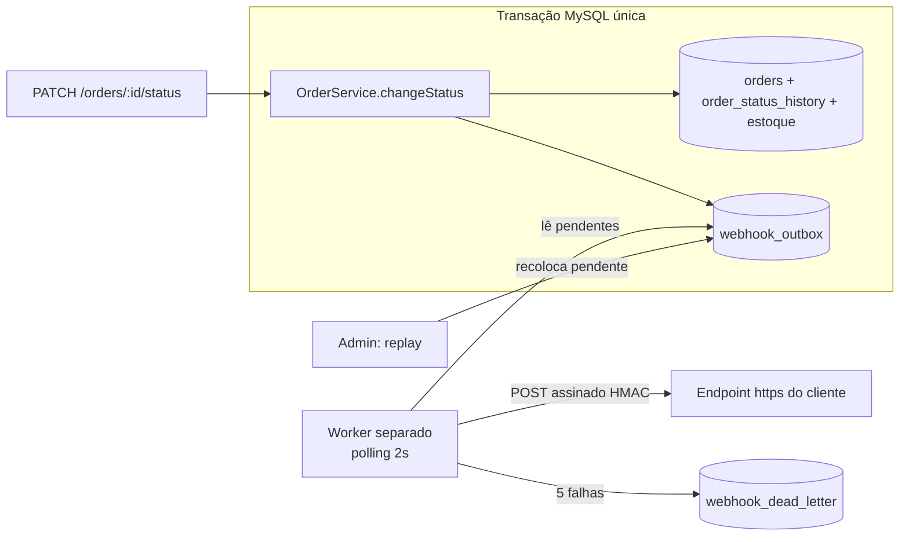

# RFC: Sistema de Webhooks de Notificação de Pedidos

## Metadados

| Campo | Valor |
|---|---|
| **Autor** | Larissa (Tech Lead) |
| **Status** | Em revisão |
| **Data** | 2026-10-07 |
| **Revisores** | Marcos (Product Manager), Bruno (Engenheiro Pleno, Pedidos), Diego (Engenheiro Sênior, Plataforma), Sofia (Engenheira de Segurança) |
| **Origem** | Reunião técnica de quinta-feira, 09:00 ([TRANSCRICAO.md](../TRANSCRICAO.md)) |
| **Documentos ligados** | [PRD](PRD.md) · [FDD](FDD.md) · [ADRs](adrs/) · [Tracker](TRACKER.md) |

---

## 1. Resumo executivo

Propomos notificar clientes B2B, via **webhooks HTTP outbound**, sempre que um pedido deles muda de status no OMS. A mudança de status passa a gravar um evento em uma **tabela outbox no MySQL**, na mesma transação que já atualiza o pedido. Um **worker em processo separado** lê essa tabela a cada 2 segundos e entrega os eventos **assinados com HMAC-SHA256**, com **retry exponencial**, **DLQ** e garantia **at-least-once**. A solução não adiciona infraestrutura nova e segue os padrões que já existem na codebase.

## 2. Contexto e problema

Atlas Comercial, MaxDistribuição e Nova Cargo pediram formalmente para receber, em tempo real, as mudanças de status dos seus pedidos. Hoje eles fazem polling em `GET /orders`, o que deixa a integração lenta e cara para eles. A Atlas sinalizou que pode migrar para um concorrente se a entrega não sair até o fim do trimestre ([09:00] Marcos). Para os clientes, "tempo real" significa **menos de 10 segundos** ([09:02] Marcos).

O OMS não tem hoje nenhum mecanismo de eventos, filas ou webhooks. A mudança de status é feita em `OrderService.changeStatus` (`src/modules/orders/order.service.ts`), dentro de uma transação que já atualiza `orders`, insere em `order_status_history` e mexe no estoque ([09:04] Bruno). Qualquer solução precisa conviver com essa transação sem torná-la dependente de um sistema externo.

## 3. Proposta técnica

### 3.1 Visão geral

### 3.2 Componentes

1. **Outbox transacional** ([ADR-001](adrs/ADR-001-outbox-no-mysql.md)). A gravação do evento é atômica com a mudança de status: commit grava ambos, rollback descarta ambos. O evento é filtrado pelos status que cada webhook quer ouvir e gravado como **snapshot** do pedido no momento da transição ([ADR-007](adrs/ADR-007-payload-snapshot-e-filtro-na-insercao.md)).
2. **Worker dedicado** ([ADR-002](adrs/ADR-002-worker-separado-em-polling.md)). Novo entry-point, separado da API, mesmo banco e mesma stack. Polling de 2 s, uma instância nesta fase.
3. **Entrega resiliente** ([ADR-003](adrs/ADR-003-retry-backoff-e-dlq.md)). Timeout de 10 s por chamada, 5 tentativas com backoff de 1m/5m/30m/2h/12h e, depois disso, DLQ com replay manual por ADMIN.
4. **Segurança** ([ADR-004](adrs/ADR-004-hmac-sha256-secret-por-endpoint.md)). HMAC-SHA256 com secret única por endpoint, rotação com grace period de 24 h e URL obrigatoriamente `https`.
5. **Semântica de entrega** ([ADR-005](adrs/ADR-005-at-least-once-com-x-event-id.md)). At-least-once; o cliente deduplica por `X-Event-Id`.
6. **API de gestão**. CRUD de configuração de webhooks, rotação de secret, histórico de entregas e replay de DLQ, seguindo os padrões de módulo, erros, validação e autorização do projeto ([ADR-006](adrs/ADR-006-reuso-dos-padroes-do-projeto.md)).

Contratos, modelo de dados, matriz de erros e fluxos detalhados estão no [FDD](FDD.md).

### 3.3 Garantias e limites propostos

| Propriedade | Proposta |
|---|---|
| Latência de notificação | até ~2 s de espera de polling + tempo de entrega; meta < 10 s |
| Entrega | at-least-once |
| Ordenação | por pedido, enquanto houver um único worker; **sem** ordenação global |
| Disponibilidade da mudança de status | independente da disponibilidade do cliente |
| Janela de retry | ~15 h antes da DLQ |

## 4. Alternativas consideradas

### ALT-01: Disparo síncrono dentro de `changeStatus`
Chamar o endpoint do cliente dentro da transação de mudança de status.
- **Trade-off que levou ao descarte:** acoplaria a latência e a disponibilidade de um sistema externo à transação mais crítica do OMS. Um cliente lento travaria mudanças de status de outros pedidos e um cliente fora do ar exigiria um rollback de status sem sentido ([09:04] Bruno, [09:06] Diego).

### ALT-02: Redis Streams (ou outro broker dedicado)
Publicar os eventos em uma fila externa.
- **Trade-off que levou ao descarte:** ganharia reatividade e escala, mas exigiria subir e operar infraestrutura nova; para um time pequeno foi considerado overengineering. Além disso, perderia a atomicidade com a transação do MySQL que a outbox oferece de graça ([09:07] Larissa, [09:07] Diego).

### ALT-03: Trigger de banco para acordar o worker
Usar trigger do MySQL para reagir à inserção, no estilo `NOTIFY/LISTEN` do Postgres.
- **Trade-off que levou ao descarte:** o MySQL não notifica processos externos; seria preciso improvisar (arquivo, chamada HTTP). O polling de 2 s já cumpre o requisito de < 10 s com muito menos complexidade ([09:09] Bruno, [09:09] Diego).

### ALT-04: Garantia exactly-once
- **Trade-off que levou ao descarte:** exigiria coordenação entre os dois lados e muito mais complexidade. At-least-once com `event_id` é o padrão de mercado e cobre a grande maioria dos casos, ao custo de transferir a deduplicação ao cliente ([09:25] Diego, [09:25] Sofia).

### ALT-05: Retry indefinido, ou apenas 3 tentativas
- **Trade-off que levou ao descarte:** retry indefinido deixa eventos pendurados para sempre; 3 tentativas cobrem só ~30 min e não sobrevivem a uma manutenção planejada de 2 h ([09:15] Diego, [09:16] Bruno, [09:16] Diego).

## 5. Questões em aberto

| # | Questão | Situação | Fonte |
|---|---|---|---|
| Q1 | **Rate limiting de saída por cliente.** Se 50 pedidos de um cliente mudam de status em um minuto, enviamos 50 chamadas? | Fora do escopo desta entrega; "observar e decidir depois" | [09:38] Diego, [09:39] Larissa |
| Q2 | **Escala para múltiplos workers.** Particionar por `order_id` ou usar lock pessimista? | Adiado; hoje é single-worker por limitação conhecida | [09:13] Diego, [09:13] Larissa |
| Q3 | **Notificação por email ao cliente quando o webhook falha repetidamente.** | Adiado para a próxima fase, "depois que a gente medir o impacto" | [09:37] Marcos, [09:37] Larissa |
| Q4 | **Endurecer as permissões do CRUD de configuração.** Hoje qualquer role autenticada pode gerenciar. | "Mais pra frente a gente pode endurecer" | [09:37] Sofia |
| Q5 | **Como o `customer_id` é informado no cadastro:** no body ou no path? | A reunião decidiu que não vem do JWT, mas não fechou a forma; o FDD propõe body e pede confirmação | [09:32] Larissa |
| Q6 | **Arquivamento de eventos entregues** (sugestão de ~30 dias). | Fora do escopo desta feature | [09:08] Diego |

## 6. Impacto e riscos

**Impacto no sistema existente**
- `changeStatus` ganha uma escrita a mais dentro da transação. Se ela falhar, a mudança de status falha junto, o que é intencional ([09:40] Bruno).
- Novo processo em produção (`npm run worker`) para operar e monitorar ([09:11] Larissa).
- Novas tabelas no schema Prisma; nenhuma tabela existente muda de estrutura.
- Nenhuma mudança nos contratos atuais da API.

**Impacto nos clientes**
- Precisam expor um endpoint `https`, validar `X-Signature` e deduplicar por `X-Event-Id`. Marcos documenta isso no portal de desenvolvedor ([09:26] Marcos, [09:40] Marcos).

**Riscos de arquitetura**

Riscos de negócio estão no [PRD](PRD.md) e riscos de implementação no [FDD](FDD.md).

| Risco | Prob. | Impacto | Mitigação na proposta |
|---|---|---|---|
| Transação de `changeStatus`, que já é pesada, fica mais lenta com a escrita na outbox | Baixa | Mudança de status mais lenta para operadores | Só uma inserção por webhook interessado, com filtro na origem ([09:04] Bruno, [09:34] Bruno) |
| Teto de escala do single-worker: volume cresce e um worker não dá conta | Baixa no curto prazo | Atraso acima de 10 s | Limitação aceita; caminho de evolução já identificado na Q2 ([09:13] Diego) |
| Vazamento de secret compromete mais de um cliente | Média | Terceiros forjam notificações | Escopo da secret limitado a um endpoint e rotação com grace de 24 h ([09:21] Sofia, [09:22] Diego) |
| Rajada de eventos de um único cliente | Baixa | Cliente sobrecarregado; outros clientes atrasam | Observar em produção; rate limiting é a Q1 ([09:38] Diego, [09:39] Larissa) |

## 7. Decisões relacionadas

| ADR | Decisão |
|---|---|
| [ADR-001](adrs/ADR-001-outbox-no-mysql.md) | Padrão Outbox no MySQL existente |
| [ADR-002](adrs/ADR-002-worker-separado-em-polling.md) | Worker em processo separado, polling de 2 s |
| [ADR-003](adrs/ADR-003-retry-backoff-e-dlq.md) | Retry com backoff (5 tentativas) e DLQ em tabela separada |
| [ADR-004](adrs/ADR-004-hmac-sha256-secret-por-endpoint.md) | HMAC-SHA256 com secret por endpoint e rotação |
| [ADR-005](adrs/ADR-005-at-least-once-com-x-event-id.md) | At-least-once com deduplicação por `X-Event-Id` |
| [ADR-006](adrs/ADR-006-reuso-dos-padroes-do-projeto.md) | Reuso máximo dos padrões do projeto |
| [ADR-007](adrs/ADR-007-payload-snapshot-e-filtro-na-insercao.md) | Payload snapshot e filtro de status na inserção |

## 8. Próximos passos de revisão

- Sessão de revisão do desenho com Bruno e Diego antes de começar a codar ([09:50] Larissa).
- Revisão de segurança da Sofia, com pelo menos 2 dias úteis, antes do deploy ([09:46] Sofia).
